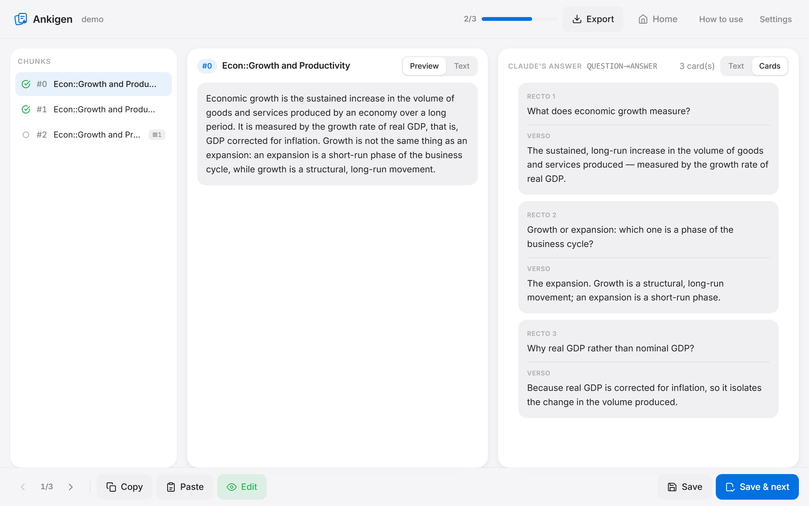
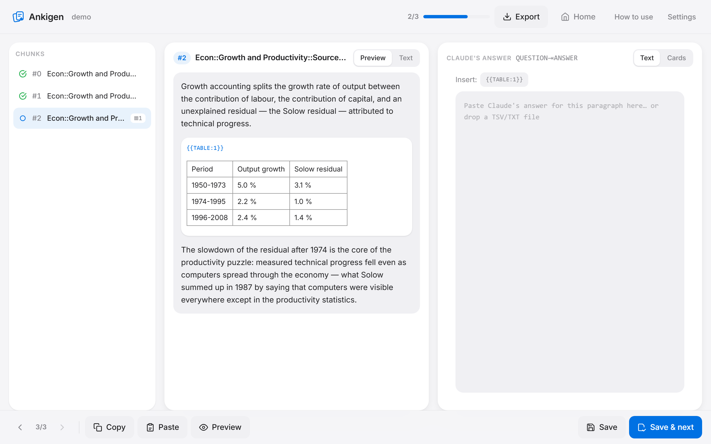
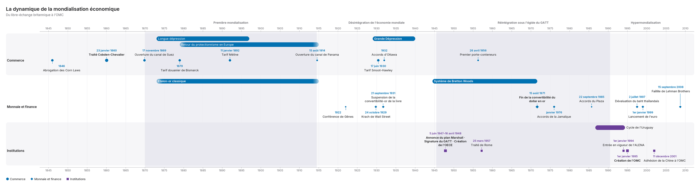

# Ankigen

**Turn a `.docx` course into an Anki deck, one paragraph at a time.**

[](LICENSE)
[](https://github.com/leoprosy/Anki-Gen/releases/latest)
[](https://github.com/leoprosy/Anki-Gen/releases/latest)

[**Download for Windows**](https://github.com/leoprosy/Anki-Gen/releases/latest) · [Contributing](CONTRIBUTING.md) · [Discussions](https://github.com/leoprosy/Anki-Gen/discussions) · [🇫🇷 Lire en français](README.fr.md)



---

## Why

Making flashcards is the slowest part of studying, and pasting a whole chapter into a chatbot does not fix it: the model skims, the cards come out shallow, and every image and table in the document is lost on the way.

Ankigen keeps the document's structure instead of flattening it. It splits the course along its heading styles, hands you **one paragraph at a time** — with the images and tables that belong to it — and turns each heading path into an Anki deck path. You send that paragraph to Claude (or any assistant you like), paste the answer back, and Ankigen takes care of the plumbing: placeholders for media, HTML tables, the `#separator:tab` header, the media files copied into your Anki collection.

Course processing runs entirely on your machine. There is **no API key and no account** required — the cards are written in the chat you already pay for, and course contents stay on your computer except the paragraph you choose to paste.

Optional usage statistics are **off until you agree** in the first-launch prompt
or in Settings. You can allow all, decline all, or choose installation/activity
and creation/export statistics separately. You can change your choice later.
Documents, filenames and card contents are never included.
See [privacy and owner dashboard setup](docs/analytics.md) for the exact fields
and metric definitions.

---

## Install

**Windows (recommended).** Download the latest `Ankigen_x.y.z_x64-setup.exe` from the
[releases page](https://github.com/leoprosy/Anki-Gen/releases/latest) and run it.
Python is not required — the installer ships everything.

**From source (Windows, macOS, Linux).** See [Run from source](#run-from-source) below.

---

## How it works



1. **Import** a `.docx` whose headings use real heading styles (`Heading 1`, `Heading 2`, … or their
   French equivalents). The split relies on those styles, not on the numbering you typed.
2. **Parse.** Ankigen cuts the course into chunks, one per section, extracts the images and tables,
   and saves a project locally. The deck path of each chunk mirrors the heading hierarchy
   (`Economics::Growth and Productivity::Sources of growth`).
3. **Generate.** Copy the current chunk, send it to Claude, and let it answer in TSV
   (`question <tab> answer`). Ankigen ships no system prompt — the **How to use** page in the app
   explains how to write your own [Claude Skill](https://docs.claude.com/en/docs/agents-and-tools/agent-skills/overview)
   for card writing, and there is a template to copy.
4. **Check and save.** Paste the answer back, switch to the **Cards** tab to see the cards rendered,
   then *Save & next*.
5. **Export.** TSV alone, a ZIP with the images, or a direct copy of the media into your
   `collection.media`. Import the TSV in Anki with *File > Import* — separator, HTML and deck column
   are already declared in the file header.

Projects are persistent: close the app, come back, pick up where you left off.

---

## What it does with images and tables

**Images** are extracted to `media/<project>/` under a name derived from their SHA-1 and prefixed
with the project id (`ag_<project>_<sha1>.png`), because Anki's `collection.media` is a flat, global
namespace. A repeated image is written once. Formats Anki cannot display (emf, wmf, tiff, bmp…) are
converted to PNG, and anything wider than 1200 px is downscaled. The document's **alternative text**
travels with the paragraph; when it is missing, the interface highlights the image and lets you type
a description, and the prompt is rebuilt immediately.

**Tables** are rebuilt with their merges (`colspan` / `rowspan`), their nested tables and the images
inside their cells. They are sent to Claude as **markdown** (cheap in tokens) and re-injected into
the cards as **self-contained HTML** (inline CSS, horizontal scrolling on mobile).

**Placeholders.** The model never writes an `` tag or a file name. It writes markers, which
Ankigen resolves at export time:

| Marker | Becomes |
|---|---|
| `{{IMG:1}}` | `` |
| `{{TABLE:1}}` | the full table, as HTML |

Numbering is **local to the chunk**. A marker the model invented is dropped at export and reported;
buttons in the interface insert a forgotten one, and the **Cards** tab shows the final rendering
before you import anything.

---

## Timelines



A course is full of dates, and a pile of cards hides how they relate. From the work view, the
**Timelines** menu opens the course's existing timelines or turns a paragraph, a chapter or the
whole course into a chronological timeline: tracks, periods, eras and events on a single drawing.
The shared **Course / Timelines** navigation preserves the current paragraph. Source links lead
back to course paragraphs and, when a quotation identifies it unambiguously, an event's source.

- **Claude extracts, Ankigen draws.** The copied prompt asks for one JSON document
  (`ankigen.timeline/1`, [JSON Schema](static/schemas/timeline-v1.json)) and nothing else. Ankigen
  computes the layout itself, so labels never overlap: what does not fit moves to numbered notes
  under the timeline.
- **Checked against the course.** Every date comes with the sentence it was taken from, and
  Ankigen looks for that sentence in the course. Dates it cannot find are flagged; dates the model
  added from its own knowledge (enriched mode) are marked as such and kept out of the cards.
- **Long chapters, paragraph by paragraph.** Past about 25,000 characters, Ankigen suggests one
  prompt per paragraph and merges the answers: tracks with the same name are matched, and an event
  found twice becomes one, which you can split again.
- **Or a local model, without Claude.** Settings → *Local model* downloads a small model once
  (Qwen3-4B, 2.5 GB) that runs inside Ankigen, on the CPU, with no account and no connection.
  *Generate locally* then extracts the current paragraph, and the model fixes its own rejected
  answers. It is slow — several minutes per paragraph on a CPU — and meant for paragraph-by-paragraph
  extraction; Claude stays better on long or tricky chapters.
- **Exports.** PNG, JPEG, WebP, PDF (A4, A3 or fitted to the content, at 300 dpi), SVG with the
  typeface embedded, JSON, or a copy to the clipboard.
- **Cards.** The timeline writes its own cards, without Claude — "In which year…?", period bounds,
  putting events in order, before and after, and pictures of the timeline with one event hidden.
  They export like the course's cards, and re-importing updates the notes instead of duplicating
  them.

The **How to use** page in the app details the format, the limits (Gregorian calendar as written,
no Julian conversion) and an optional Claude Skill for timelines.

---

## Use from Claude (MCP)

Ankigen can run as a local [MCP](https://modelcontextprotocol.io) server, so Claude imports a course,
writes the cards of each paragraph, builds timelines and exports them itself — no copy-paste.
It works on the same data as the app, even when the app is closed, and its tools update with the app.

Register it once (Claude Code; for Claude Desktop, put the same command in `claude_desktop_config.json`):

```bash
claude mcp add --scope user ankigen -- "%LOCALAPPDATA%\Ankigen\flask-server.exe" --mcp
```

From source, point it at the repo instead (it then uses the repo's data folders):

```bash
claude mcp add --scope local ankigen-dev -- ".venv/Scripts/python.exe" "launcher.py" --mcp
```

Tools: `guide`, `list_projects`, `import_docx`, `set_deck_prefix`, `get_paragraphs`, `save_cards`, `export_project`,
`list_timelines`, `create_timeline`, `update_timeline`, `export_timeline`.

---

## Run from source

```bash
git clone https://github.com/leoprosy/Anki-Gen.git
cd Anki-Gen
python -m venv .venv
.venv/Scripts/python.exe -m pip install -r requirements.txt   # Windows
# source .venv/bin/activate && pip install -r requirements.txt  # macOS / Linux
.venv/Scripts/python.exe app.py
```

Then open <http://127.0.0.1:5000>. Change the port with `ANKI_GEN_PORT` (handy when the installed
app already holds 5000):

```bash
ANKI_GEN_PORT=5051 .venv/Scripts/python.exe app.py
```

To run the desktop shell in dev mode, start the Flask server first, then:

```bash
npm install
npm run tauri dev
```

---

## Build the Windows app

The desktop app is a [Tauri](https://tauri.app) shell around the Flask server, which is compiled
into a standalone "sidecar" binary with PyInstaller.

```powershell
# 1. Sidecar — nothing to list by hand: the spec works out the app's modules from its imports
.venv\Scripts\pyinstaller.exe --noconfirm flask-server.spec
.\dist\flask-server.exe --self-check   # imports the embedded code, exercises Pillow, lxml…

# 2. Hand it to Tauri under its target triple (-gnu if you use the GNU toolchain)
Copy-Item dist\flask-server.exe src-tauri\binaries\flask-server-x86_64-pc-windows-msvc.exe -Force

# 3. Bundle
npm run build
```

The installers land in `src-tauri/target/release/bundle/`. Pushing a `v*` tag runs the same steps in
CI ([`.github/workflows/release.yml`](.github/workflows/release.yml)) and attaches the `.exe` and
`.msi` to the release.

**Updates ship code, not the runtime.** The built-in updater replaces the app's code (`app.zip`)
but keeps the executable the user installed. That executable therefore embeds the whole standard
library and every submodule of the runtime dependencies, so a new `import` never needs a new
installer. Only a new dependency does: `runtime.json` numbers the runtime, `app.zip` declares the
runtime it requires, and the updater sends users to the installer instead of breaking their app.
Before each release, CI runs the new code on the previous release's executable
([`scripts/check_runtime_compat.py`](scripts/check_runtime_compat.py)).

---

## Where the data lives

- **From source** (`python app.py`): in the project folder — `projects/`, `uploads/`, `media/`,
  `exports/`, `timelines/`.
- **In the packaged app**: in `%APPDATA%\AnkiGen\` (`settings.json`, `projects/`, `uploads/`,
  `media/`, `exports/`, `timelines/`). This matters — a PyInstaller *onefile* executable is unpacked
  into a temporary folder, and anything written there disappears when the app closes.

Each timeline is one JSON file in `timelines/`. The pictures of its cards are rendered on demand
into `media/_timelines/<timeline>/` and deleted with the timeline. The local model, once
downloaded, lives in `models/` (2.5 GB); Settings deletes it.

---

## Tests

```bash
.venv/Scripts/python.exe -m unittest discover -s tests
node --test "tests/*.js"
```

The `.docx` fixtures (images with and without alt text, a lone image in a paragraph, a repeated
image, horizontal and vertical merges, a nested table, an image inside a cell) are generated on the
fly by `tests/make_fixtures.py` — no binary file is versioned. The timeline fixtures are JSON
documents in `tests/fixtures_timeline/`; `scripts/timeline_gallery.py` renders them all, in every
theme, into `exports/gallery/` for visual review. The JavaScript tests (timeline editor, updater)
need nothing but Node 22 or later, which expands the quoted pattern itself.

---

## Contributing

Issues labelled [`good first issue`](https://github.com/leoprosy/Anki-Gen/issues?q=is%3Aissue+is%3Aopen+label%3A%22good+first+issue%22)
are the best place to start, and [CONTRIBUTING.md](CONTRIBUTING.md) has the setup, the conventions
and the layout of the code. Card-writing Skills, deck conventions and workflow ideas belong in
[Discussions](https://github.com/leoprosy/Anki-Gen/discussions).

## License

Ankigen is free software, released under the **GNU General Public License v3.0 or later**.
See [LICENSE](LICENSE). Copyright (C) 2026 leoprosy.

Timelines are drawn with the [Inter](https://github.com/rsms/inter) typeface (v4.1),
Copyright (c) 2016 The Inter Project Authors, shipped in `static/fonts/` under the
[SIL Open Font License 1.1](static/fonts/OFL.txt).
